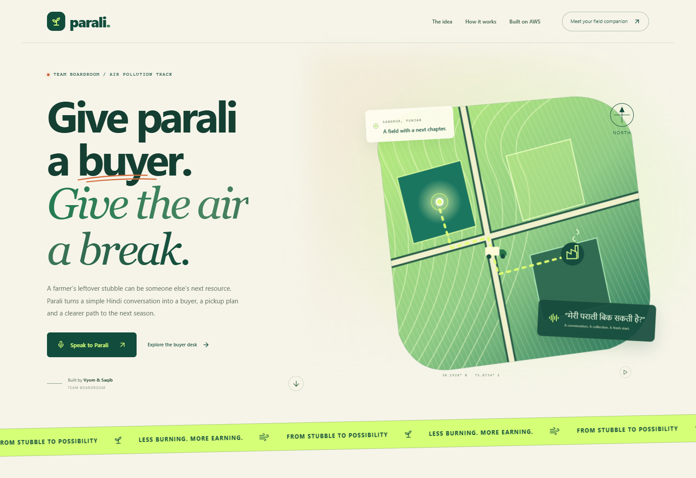
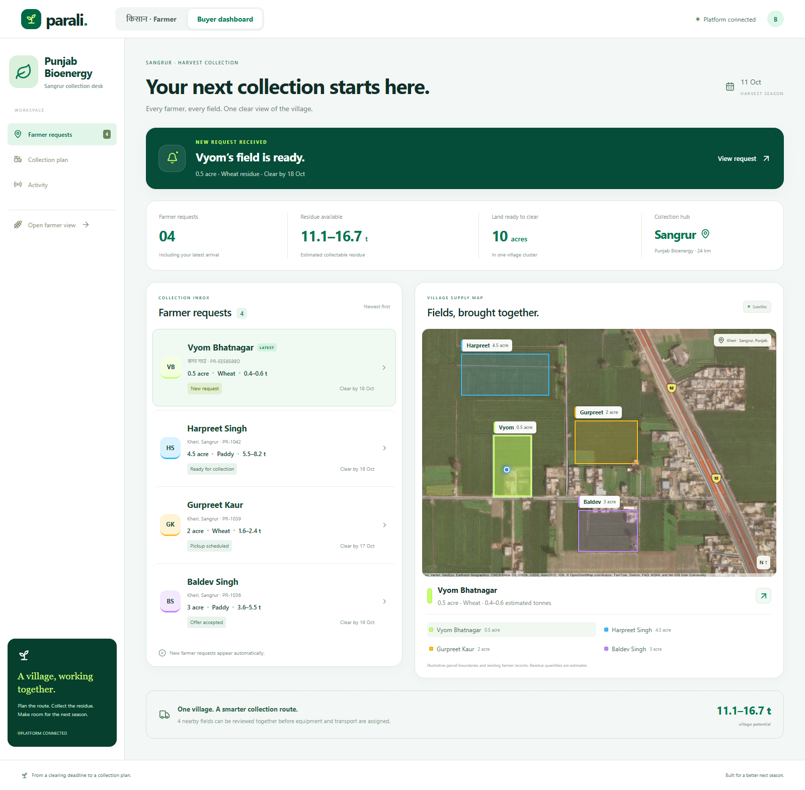
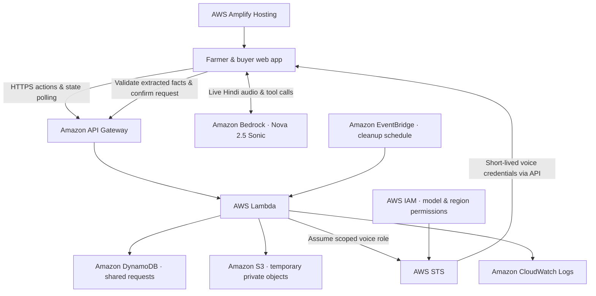
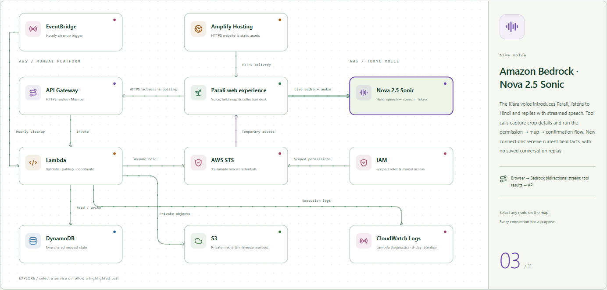

<div align="center">

# 🌱 Parali

### Give parali a buyer. Give the air a break.

**A Hindi voice companion that turns crop residue into a collection request.**

Built by **Team Boardroom · Vyom & Saqib** for the **Air Pollution** track.

[Explore Parali](https://demo.d1riy18awh1bmx.amplifyapp.com/) · [Farmer experience](https://demo.d1riy18awh1bmx.amplifyapp.com/farmer) · [Buyer dashboard](https://demo.d1riy18awh1bmx.amplifyapp.com/buyer)

</div>



## A better next season starts with a clear field

Between harvests, farmers need to clear their fields quickly. Selling leftover stubble should be an accessible alternative to burning it, but finding a buyer is only the first step: pickup dates, balers, loading and transport also need to line up.

Parali brings those steps together. A farmer explains their field in Hindi, confirms its location and sends a request. A biomass buyer sees the request alongside nearby fields, proposes collection and follows it through to completion. The intended environmental benefit is less incentive to burn crop residue by giving it a useful destination and a clear collection plan. The project does not claim measured emissions reductions.

## What it does

| For the farmer | For the buyer |
| --- | --- |
| Natural Hindi conversation with Amazon Nova Sonic | A village inbox with the newest farmer request at the top |
| An introduction when the microphone starts | Existing farmer profiles and color-coded, separate land parcels |
| A microphone that reacts to voice levels | Village acreage and estimated residue totals |
| Crop, acreage, dates and access fill in while speaking | A ready collection offer with equipment and pickup options |
| Spoken corrections update the field details | Farmer payment, baling, loading, transport and total costs |
| Satellite field confirmation with a boundary and location dot | Collection scheduling and a replacement-baler flow |
| A request page, collection date and **their payment amount** | Shared progress, activity updates and a collection receipt |
| Reset starts a fresh field and conversation | Changes appear through the shared application state |

The farmer sees what they will receive. Internal collection costs stay on the buyer's dashboard.



## Walk through the experience

1. Open **Farmer** and press the microphone. Parali introduces itself in Hindi.
2. Describe the crop and field: **“मेरे पास तीन एकड़ गेहूँ की पराली है।”** Give the village, availability, clearing deadline and vehicle access as prompted. Typed input is also available.
3. Allow the location step, inspect the highlighted field and confirm it by voice. The walkthrough uses an illustrative village parcel; device GPS coordinates are discarded.
4. Send the request. The request page shows the collected information and farmer profile.
5. Open **Buyer dashboard**, select the latest request and send a collection offer.
6. Return to **Farmer**, review the pickup date and payment, then accept.
7. Confirm collection on the buyer side. Optionally arrange a replacement baler and ask the farmer to approve the revised plan.
8. Mark collection complete to display the receipt. Use **Reset** on the farmer page to start again.

Both public application pages share the same presentation field; no organiser login or key entry is part of the product flow.

## Built on AWS

The application hosting, live speech intelligence, API, shared data and operational services run on AWS. Esri supplies the satellite imagery; it is not an AWS service.



### How the pieces work together

| Service | Its job in Parali |
| --- | --- |
| **AWS Amplify Hosting** | Serves the React application over HTTPS, including the public landing page and farmer/buyer routes. |
| **Amazon Bedrock / Nova 2.5 Sonic** | Handles the direct, bidirectional Hindi speech conversation, spoken replies, interruption and structured tool calls. The current voice is Kiara in Tokyo (`ap-northeast-1`). |
| **Amazon API Gateway** | Exposes the application endpoints for requests, state changes and voice-session setup. |
| **AWS Lambda** | Validates field facts, runs the request/offer/approval workflow and issues temporary voice access. The API runs in Mumbai (`ap-south-1`). |
| **Amazon DynamoDB** | Stores field drafts, submitted requests, offers, status and application events so both views stay in sync. |
| **AWS Security Token Service (STS)** | Issues 15-minute credentials for the scoped Nova voice role. Permanent AWS credentials are never embedded in the frontend. |
| **AWS Identity and Access Management (IAM)** | Restricts the voice role to the selected model, region and configured access window, and scopes server permissions. |
| **Amazon S3** | Stores private temporary speech/compute artifacts for the supporting speech paths, with encryption and lifecycle cleanup. |
| **Amazon CloudWatch Logs** | Captures Lambda execution logs for troubleshooting. |
| **Amazon EventBridge** | Invokes scheduled cleanup of abandoned temporary jobs and artifacts. |
| **AWS CloudFormation / SAM** | Describes the backend, storage, roles, cleanup schedule and optional compute resources in `infra/template.yaml`. |

**Earlier paths retained in the source:** Amazon Transcribe for speech recognition, Amazon Polly for Hindi synthesis, and an EC2-hosted Qwen worker using a private S3 job mailbox. These were explored before direct Nova speech; the current Nova conversation does not run a language model on CPU. The EC2 worker is an optional fallback, not a requirement for the active voice path.



### From speech to a request

Nova proposes changes through tools. Lambda checks the proposed values against the farmer's transcript before saving them. Crop/area estimates are deterministic, and the parcel must be explicitly confirmed before publication. The buyer then reads the same request through the API. Offer acceptance, replacement and completion are explicit state changes rather than unverified promises from the voice model.

Reset closes audio and clears the field and conversation. Previous chat messages are not replayed when a new Nova connection starts.

## Run locally

**Prerequisites:** Node.js 22+, npm and a modern browser. The local text workflow works without an AWS account.

```sh
git clone https://github.com/lushain/Parali.git
cd Parali
npm ci
npm run dev
```

Open:

- `http://localhost:5173/` — mission, team and interactive architecture
- `http://localhost:5173/farmer` — farmer intake and request
- `http://localhost:5173/buyer` — village inbox and collection workflow

The local API starts on port `8787`; Vite serves the UI on `5173`. A shared local field is created automatically under ignored `.local/`. Local mode uses a deterministic text parser. Live Nova voice requires the AWS backend configuration.

Use `.env.example` as a reference if configuring AWS locally. Keep real configuration in an ignored `.env`; use an AWS profile or role rather than hardcoding credentials. Only the public API URL belongs in `VITE_API_URL`.

## Build, test and deploy

```sh
npm test                # domain, grounding, voice lifecycle and API tests
npm run test:e2e        # Playwright browser workflows
npm run build           # TypeScript checks + Vite production frontend
npm run build:lambda    # bundle the Node.js Lambda handler
```

Browser checks use Google Chrome as configured in `playwright.config.ts`; install Chrome or adjust the configured Playwright channel on your machine. Live checks under `scripts/` are opt-in and require your own ignored session configuration; do not run them against someone else's shared field.

For AWS deployment:

1. Build the frontend and Lambda bundle.
2. Review `infra/template.yaml` and provide your own frontend origin, server maintenance secret and UTC voice-access expiry. VPC/subnet values are needed only for the optional EC2 path; verify its regional AMI before use.
3. Package the SAM template and deploy it to your AWS account. `scripts/package.ps1` prepares manual artifacts; its frontend packaging expects a private `.local/live-demo.json` describing your own application field.
4. Set the frontend's `VITE_API_URL` to your API origin and generate a `platform.json` for your own presentation field. The file contains bounded farmer/buyer application capabilities, **not AWS credentials**; generated versions stay out of Git.
5. Host the rebuilt frontend on Amplify. Apply the rewrites and headers in `infra/amplify-rewrites.json` and `infra/customHttp.yml`.
6. Enable access to the chosen Bedrock model and test a fresh microphone conversation in your account.

The repository does not contain the original account's deployment parameters, maintenance key, live session files or environment files. Availability of the hosted voice depends on its configured access window and AWS account/model access. New deployments incur AWS usage charges; review permissions and usage controls before provisioning.

## Project layout

```text
src/       React pages, live audio, microphone feedback and styles
shared/    Field schemas, residue estimates and collection economics
server/    API handlers, state, grounding and AWS integrations
infra/     SAM infrastructure and optional EC2 worker
public/    Attributed satellite assets and a fixed Hindi UI announcement
scripts/   Packaging, map-asset generation and opt-in verification tools
tests/     Unit tests and Playwright workflows
docs/      Reviewed product screenshots and public project notes
```

## Scope and data

This is a hackathon prototype with one shared farmer field and curated existing requests. Profiles, parcel boundaries, equipment availability, logistics and receipts are illustrative; no real booking or money transfer occurs. Residue tonnage is an acreage-based estimate, not a weighbridge reading. The parcel animation illustrates location confirmation, not automated cadastral surveying or satellite-image analysis.

Satellite imagery is provided by **Esri and its listed imagery contributors**, with attribution retained on the images. The asset-fetch script reads a local Esri key from ignored `.secrets.txt`; the key is not shipped in the source or website.

Private operational notes, raw transcripts, console captures, credentials and generated deployment packages are excluded from the public repository. Only reviewed product screenshots are included.

## Team & history

**Boardroom — Vyom Bhatnagar and Saqib · Air Pollution track**

The initial Git history was assembled retrospectively from the completed workspace, grouped by feature and dated **9–11 October 2026 (IST), ending at 14:00**. It records the project in reviewable sections; these dates are not a recovered log of individual editing sessions.
